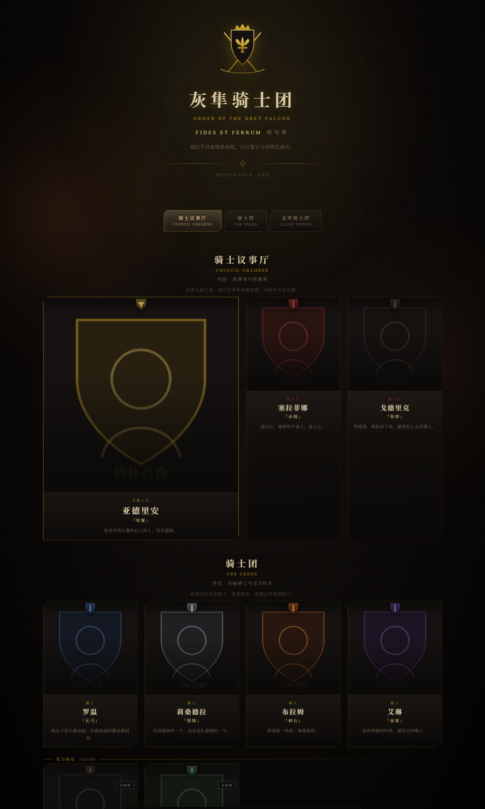

# 红龙骑士团 · 名册

> 一个中世纪骑士公会的人物画廊 —— 暗夜哥特视觉、程序化纹章生成、三级身份权限、
> 投稿审核流，纯静态前端 + 云数据库同步，无需任何构建工具。



> 本仓库不绑定任何在线演示站点 —— clone 后用任意静态服务器打开 `index.html` 即可看到效果
> （未配置云端时以离线单机版运行，功能完整）。

---

## 这是什么

一个可以让你把「一群人的资料」摆得体面的静态站点。默认皮肤是虚构的**红龙骑士团**：
三位一体的廷结构、五级封建层级、每人一枚自动生成的盾形纹章。

它不是一个套模板的卡片墙。几处花了心思的地方：

| 特性 | 说明 |
|---|---|
| **程序化纹章** | 每个人的盾徽由层级 + 色记实时生成（盾形、鸢尾、冠冕、缘饰），不是图片素材 |
| **五级封建层级** | 大骑士长 / 骑士长 / 骑士 / 见习侍从 / 客卿骑士，各有独立的盾形与装饰 |
| **三级身份** | 访客只读 → 投稿人递交待审 → 管理者审核放行，权限真正落在数据库 RLS 上 |
| **审核流** | 投稿进队列不公开；管理者通过 / 驳回并留回话；投稿人改自己已过审的条目免审 |
| **云端同步** | 云数据库是唯一真源，改完不必「发布」；手机、电脑、转发链接看到同一份 |
| **离线可用** | 不配云端就是单机版，双击 HTML 即开，编辑存本机、可导出 JSON 带走 |
| **零依赖** | 没有框架、没有 npm、没有构建步骤。原生 JS + 一份 CSS |

---

## 快速开始

### 只想看看

双击 `index.html`。（会以离线单机版运行 —— 所有编辑存在你自己的浏览器里。）

想完整跑起来（含云同步），用任意静态服务器：

```bash
python -m http.server 8000
# 打开 http://127.0.0.1:8000
```

> 直接双击时同步层会自动关闭：云端凭据与 `file://` 协议配合不了，
> 而且登录也必须跑在 https 或 localhost 上。

### 怎么进编辑态

刻意做得隐蔽，免得访客误入。任选一种：

- 双击顶部**团徽**
- 快捷键 `Ctrl + Shift + E`
- 地址栏加 `#forge`
- 页脚的 `✠` 连点三下

底部会升起工具条。

### 开启云同步

1. 在云服务里建一个应用，拿到 `endpoint` 与 `publishableKey`
2. 用本仓库的 [`docs/schema.sql`](docs/schema.sql) 把五张表和权限策略建出来
3. 复制配置模板并填写：

   ```bash
   cp assets/cloud.config.example.js assets/cloud.config.js
   # 然后编辑 assets/cloud.config.js
   ```

4. 刷新页面 → 进编辑态 → 点底部的「云同步状态」按钮 → 注册或登录

**第一个登录的账号会自动成为管理者**（白名单表为空时自助激活）。之后要加人，
往 `gallery_admins` 表插一条 `uid`。

> `assets/cloud.config.js` 被 `.gitignore` 排除 —— 云凭据属于每个人自己，不进版本库。
> 没有这个文件时，页面照常打开，只是云同步关闭。

---

## 三种身份

这是整个项目的核心，值得单独说清楚。

| 身份 | 怎么获得 | 能做什么 | 改动去哪 |
|---|---|---|---|
| **访客** | 打开网址即得 | 看已上线成员、翻详情页、换廷导航 | 只读 |
| **投稿人** | 注册 / 登录一个邮箱 | 递交新成员；改自己已过审的成员 | 新递交 → 待审队列；已过审的 → 立即生效 |
| **管理者** | 白名单账号，或首位登录者 | 录入即上线、审核通过/驳回、改所有人、改团徽箴言 | 全部直传云端 |

三层的关键在于**前端隐藏按钮只是观感，真正拦截在数据库**：

```
访客的写入      → RLS 直接拒绝（没有策略放行）
投稿人改别人的  → owner_id ≠ auth.uid()，拒绝
投稿人自己上线  → 只能改 gallery_members，改不了 gallery_published
管理者的写入    → 策略里那条 EXISTS(gallery_admins …) 放行
```

所以即使有人打开控制台手动调用接口，也越不过去。

---

## 目录结构

```
knight-gallery/
├── index.html                 入口（脚本按依赖顺序加载）
├── assets/
│   ├── style.css              视觉系统：配色 / 石墙 / 炉火 / 层级差异
│   ├── heraldry.js            纹章生成器：盾形、鸢尾、冠冕、色记、五层级
│   ├── data.js                默认名册：公会信息 + 三廷 + 成员
│   ├── app.js                 渲染、详情页、粒子、隐蔽入口
│   ├── editor.js              锻造模式：增删改、肖像压缩、同名查重
│   ├── sync.js                云同步：拉取 / 上传 / 角色判定 / 去重
│   ├── review.js              登录面板、审核队列、我的投稿与回执
│   ├── cloud.config.js        你自己的云凭据（git 忽略）
│   ├── cloud.config.example.js 上面那份的模板
│   ├── img/guild_crest.png    团徽原图
│   └── vendor/                云服务 SDK（打包时内联）
├── portraits/                 成员肖像放这里
├── docs/
│   ├── 使用教程.md            面向使用者的完整说明（三种身份逐条讲）
│   └── schema.sql             云数据库建表 + RLS 策略
├── tools/debug-cdp-run.mjs    用 CDP 驱动浏览器跑断言脚本（见下文）
├── build.py                   打包成单文件 HTML + 传播 zip
└── preview.png
```

---

## 打包与部署

### 打包成单文件

```bash
python build.py
```

产出：

- `dist/红龙骑士团-名册.html` —— 全部 CSS / JS / 图片内联，**双击即开**，可当附件发送
- `dist/红龙骑士团-名册.zip` —— 单文件 + 可编辑源码版

打包脚本会把字体 CDN 换成国内可访问的镜像，并扫描是否还有没内联的本地资源引用
（漏一个，别人的电脑上就开天窗）。

> 打包时会读取 `assets/cloud.config.js` 一起内联。所以**想分享带云同步的单文件，
> 先配好云端再打包**；没有配置文件则产出的是离线单机版。

### 部署成网址

纯静态，扔到任何静态托管上即可（对象存储 / Pages / Nginx）。
若用云服务的应用托管，记得保持域名不变 —— 改了域名，已登录的会话与
OAuth 回调都会失效。

---

## 自定义

**换公会名字与简介** —— 编辑态 → 工具条「团徽与箴言」，或直接改 `assets/data.js` 的 `guild`。

**换配色** —— `assets/style.css` 顶部一组 CSS 变量就是全部设计 token：

```css
--stone-0: #0a0908;   /* 背景石材 */
--gold:    #c9a227;   /* 描边与强调 */
--parchment: #d9c9a6; /* 正文 */
--ember:   #ff8a3d;   /* 炉火 */
```

改这一组，整站气质就变了。

**换层级名** —— `assets/heraldry.js` 里的 `RANKS`：层级键、中文名、英文名、
默认纹章色、盾形与装饰都在那里。

**换团徽** —— 替换 `assets/img/guild_crest.png`（建议 1024×1024 透明底）。

---

## 技术说明

**没有框架，也没有构建。** 原生 JS，按 `<script>` 顺序加载，每个文件一个 IIFE，
只往 `window` 上挂一个命名空间（`Heraldry` / `GalleryState` / `Sync` / `Review` / `Editor`）。
这么做是为了让单文件打包变成一件平凡的事 —— 把文件内容依次塞进 `<script>` 标签就行，
不需要先说服打包器。

**纹章是算出来的。** `heraldry.js` 按纹章学的构件拼 SVG：盾形（Escutcheon）→
底色（Field）→ 主图（Charge）→ 附饰（Ordinary）→ 色记（Tincture）。
八种传统色记 + 五级层级，组合出的盾徽各不相同，且都是矢量、都随主题。

**云同步走「撞键改写」做幂等。** 每条成员有稳定的 `member_key`，上传时先试插入，
撞唯一键就转成更新 —— 这样重复提交、断网重试都不会造出多份数据。

---

## 调试

`tools/debug-cdp-run.mjs` 用 Chrome DevTools Protocol 驱动真实浏览器执行一段断言脚本。
需要登录、需要等网络的场景，headless 的 `--dump-dom` 靠不住（它会把
`setTimeout` 加速，但网络请求没走完），CDP 能真实 `await`。

```bash
# 1) 起一个带调试端口的浏览器
msedge --headless=new --remote-debugging-port=9222 --user-data-dir=/tmp/cdp about:blank

# 2) 跑表达式文件（里面写一段 async IIFE）
node tools/debug-cdp-run.mjs http://127.0.0.1:8000/index.html my-probe.txt
```

脚本内置 `Network.setCacheDisabled`、180 秒超时保险，以及
**JS 弹窗自动接管**——headless 下没人点 `alert`/`confirm`，页面会永久挂住。

---

## 已知限制

- **邮箱登录依赖 https 或 localhost。** 这是云服务的安全要求，`file://` 下登录不可用。
- **密码长度上限 24 位。** 服务端对过长密码会拒绝，前端已按此校验并给出提示。
- **肖像会自动裁成 1:1 并压到 512px。** 这是刻意的：原图直存 base64 会迅速撑爆
  浏览器存储与同步载荷（2560×1600 的截图能到 2MB 一张）。
- **一次只服务一份名册。** `rosterDoc` 支持多份，但界面只绑了 `main`。

---

## 许可

[MIT](LICENSE)。拿去改、拿去用、拿去商用都行，保留版权声明即可。

`assets/vendor/workbuddy-cloud-sdk.global.js` 是云服务的官方客户端 SDK，
版权归其提供方，随项目分发仅作为运行时依赖；不使用云同步功能的话删掉它即可
（页面会自动以离线单机版运行）。

---

## 致谢

- 视觉参考：中世纪纹章学（盾形构图、色记规则）与暗夜哥特建筑质感
- 字体：Cinzel、Noto Serif SC
- 示例名册里的骑士均为虚构人物
